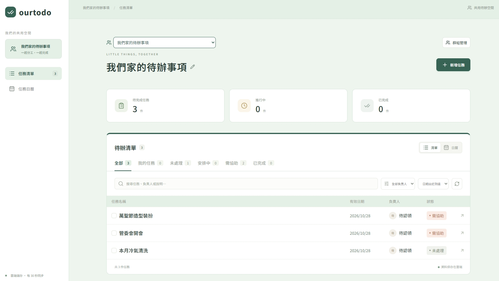
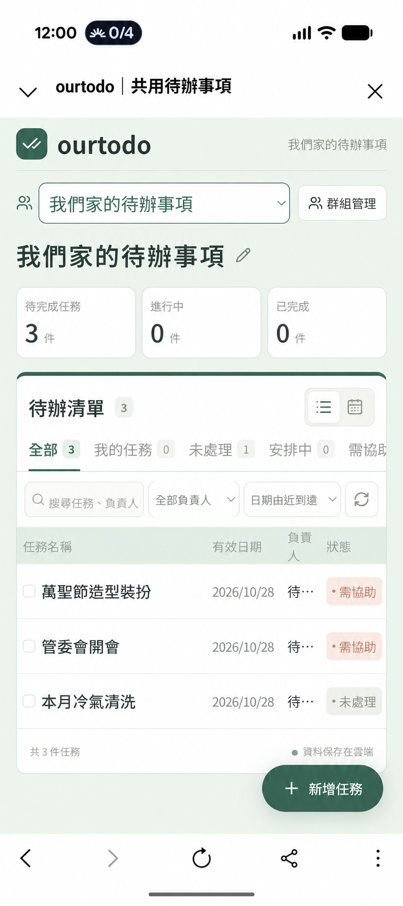
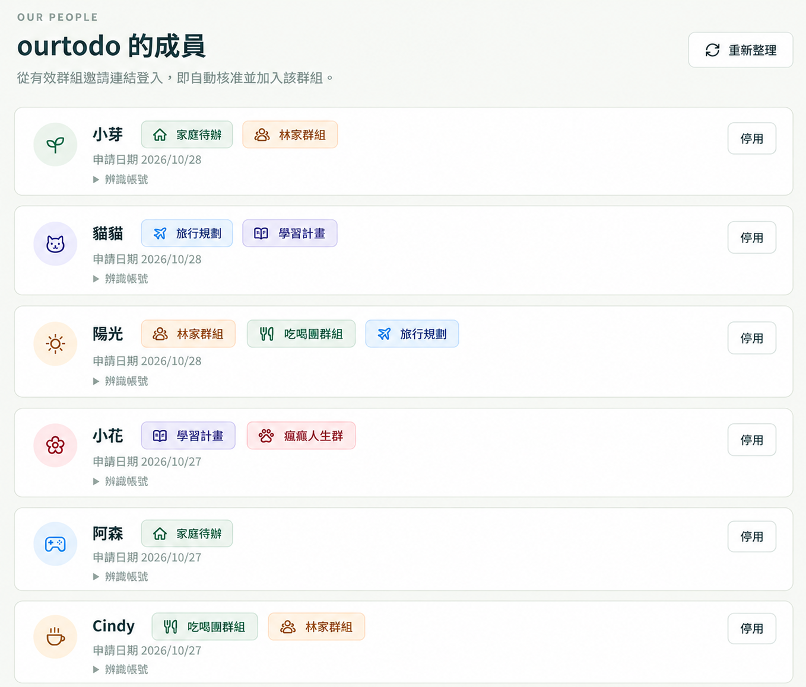

# ourtodo

手機優先、繁體中文的群組待辦網站。用 LINE 登入，從邀請連結加入群組，讓家庭、工作與活動各有自己的清單。

React / TypeScript · Cloudflare Workers / D1 · MIT

**[開啟互動 Demo](https://gitmaruneko.github.io/ourtodo-demo/)** · 無須登入，可實際新增、編輯任務與切換日曆。Demo 任務與照片僅保存在自己的瀏覽器，不連接任何正式系統。

## 操作畫面

桌面版：



手機版（已遮除私人站網址）：



成員管理介面：



## 公開互動 Demo

[前往 ourtodo Demo](https://gitmaruneko.github.io/ourtodo-demo/)。頁面頂端有 DEMO 標示，可隨時「重設示範資料」。

| 功能 | Demo |
| --- | --- |
| 範例任務、新增及編輯、四種狀態 | 可操作 |
| 我的任務、搜尋篩選、日曆 | 可操作 |
| 群組切換、清單名稱與配色 | 可操作，全部是本機示範資料 |
| 照片預覽 | 可操作；每張上限 700 KB，每項任務最多 3 張 |
| 重新整理後保留測試資料 | 使用 localStorage；限同一瀏覽器及網站來源 |
| 真實 LINE 登入、邀請、多人同步 | 不提供 |

Demo 使用本專案的 `components/task-board.tsx`、樣式與狀態定義，將登入及儲存替換為 `demo/` 的本機實作。建置產物另行發布到 [`ourtodo-demo`](https://github.com/gitmaruneko/ourtodo-demo)，由 GitHub Pages 提供靜態檔案，不部署 Worker、不使用 D1、不包含 LINE 設定。內容安全政策 `connect-src 'none'` 會封鎖網路連線，建置也會拒絕網路及伺服器依賴。

Demo 中請勿輸入敏感資料。換裝置、清除網站資料或部分隱私瀏覽模式可能讓資料消失；同一瀏覽器設定檔的其他使用者可能看得到這份本機資料。照片及任務不會上傳，與私人正式站完全分開。

```sh
npm ci
npm run build:demo
# 使用任意靜態 HTTP server 開啟 dist-demo/
```

建置及發布方式見 [Demo 架構與隔離驗證](docs/DEMO.md)。

<!-- deploy-button:start -->
[](https://deploy.workers.cloudflare.com/?url=https%3A%2F%2Fgithub.com%2Fgitmaruneko%2Fourtodo%2Ftree%2Fmain)
<!-- deploy-button:end -->

## 可以做什麼

| 功能 | 說明 |
| --- | --- |
| 多群組清單 | 同一個網站建立、加入及切換多個群組，任務與成員各自隔離 |
| 邀請自動加入 | 收到有效邀請連結的人完成 LINE 登入後，自動核准並加入對應群組 |
| 群組配色 | 森林綠、海洋藍、薰衣紫、暖陽橘、玫瑰粉、石墨灰；各群組獨立儲存 |
| 群組管理 | 修改共用名稱、查看與移除成員、複製及更新邀請連結 |
| 快速編輯 | 點選任務直接編輯；新增時日期預設為台灣時間當天，負責人預設為自己 |
| 分工與狀態 | 從群組成員選擇負責人，也可選「待認領」；以按鈕切換四種狀態 |
| 搜尋與篩選 | 全部、我的任務、未處理、安排中、需協助、已完成，以及負責人、關鍵字與日期篩選 |
| 清單與日曆 | 精簡手機排版，統計同排顯示；可切換日曆查看日期 |
| 成員資訊 | 名字旁顯示群組名稱與配色，支援一位成員加入多個群組 |
| 更新保護 | 多人編輯時拒絕過期版本，避免覆蓋別人的修改；頁面每 30 秒同步 |

這是網頁應用程式，不需要 LINE 聊天機器人或 Messaging API。群組由網站管理，不會讀取或同步 LINE 聊天室、好友名單。

本分支 `main` 不提供照片上傳，部署只需要 D1，不需要開通 R2。需要照片版本時，請另外閱讀 [`with-r2` 分支](https://github.com/gitmaruneko/ourtodo/tree/with-r2) 的說明；該分支的功能組合與本分支不同。

## 部署到自己的 Cloudflare

需要 Node.js 24 LTS（最低 22.13）、Git、Cloudflare 帳號及自己的 LINE Login channel。

```sh
git clone --branch main https://github.com/gitmaruneko/ourtodo.git
cd ourtodo
npm ci
npm run cf:login
npm run setup
npm run deploy
```

`setup` 會詢問網站名稱及 LINE 設定，建立或重用 D1 資料庫，將部署者自己的設定寫入 Git 忽略的 `wrangler.local.json`。`deploy` 會建置、套用尚未執行的 migration，再更新 Worker。

LINE 設定尚未準備好時可先留空。部署後開啟 `/line-setup` 查看設定步驟；未設定完成前，任務與成員 API 保持封鎖。完成設定後重新執行 `setup` 和 `deploy`。

多人部署時，每個人都使用自己的 Cloudflare 與 LINE 設定，不會連線到原作者的資料庫。若在同一資料夾切換分支，請重新執行 `setup` 與 `build`，避免沿用舊設定及建置結果。

### 使用 Cloudflare 部署按鈕

上方按鈕固定使用 `main`。Cloudflare 網頁部署請設定：

- Build command：`npm run build`
- Deploy command：`npm run deploy -- --skip-build`

Cloudflare 會依 `wrangler.json` 配置 D1，部署時透過 `DB` binding 套用 migration。請在 Worker 環境設定填入 LINE 的三項值，並保持 `AUTH_MODE=line`。參考 [Cloudflare 部署按鈕說明](https://developers.cloudflare.com/workers/platform/deploy-buttons/)。

若分享自己的 fork，可更新部署按鈕：

```sh
npm run add-deploy-button -- https://github.com/你的帳號/你的專案 --branch main
```

## 設定 LINE

在 [LINE Developers Console](https://developers.line.biz/console/) 建立自己的 LINE Login channel，App types 選 `Web app`。新增 LIFF app：Size 選 `Full`，Endpoint URL 填自己的 HTTPS 網址，Scopes 僅選 `openid` 和 `profile`。

| 設定 | 取得位置 |
| --- | --- |
| `LINE_CHANNEL_ID` | Basic settings → Channel ID |
| `LINE_LIFF_ID` | LIFF → LIFF ID |
| `LINE_ADMIN_USER_ID` | Basic settings → 網站管理員本人的 Your user ID |

不需要 Channel secret，也不申請使用者的 Email 權限。先由管理員測試，再將 channel 設為 `Published`，讓一般使用者登入；`Developing` 只允許 channel Admin 或 Tester。發布後無法改回 Developing。

詳細步驟及驗收方式見 [LINE 登入設定](docs/LINE-SETUP.md)。

## 開始一起使用

1. 網站管理員用設定的 LINE 帳號登入。
2. 在「群組管理」建立群組，選擇清單配色。
3. 複製群組邀請連結，分享給要邀請的人。
4. 收到連結的人完成 LINE 登入後，自動核准並加入該群組，不需要再等待管理員。
5. 新增任務、選擇群組成員或「待認領」，開始分工。

**邀請連結等同加入資格，請只分享給要邀請的人。** 群組管理員可以更新連結使舊連結失效。移除成員後，若不希望對方透過舊連結再次加入，請同時更新邀請連結。已停用的網站帳號不會因邀請連結自動重新開通。

一般首頁登入但沒有有效邀請的人仍需網站管理員核准；不會被任意分派群組。網站管理員可管理帳號，群組管理員可管理自己的群組；網站管理員不會自動取得其他人新建群組的任務存取權。

群組操作、角色與舊資料升級說明見 [群組待辦清單](docs/GROUPS.md)。

## 升級既有部署

```sh
npm ci
npm run deploy
```

請保留自己的 `wrangler.local.json`。部署會自動套用 migration，既有任務及升級當時已核准的成員會保留在「原有共用清單」，由原網站管理員管理。新建群組從空白清單開始。

不會刪除舊任務或歷史照片；新增照片仍保持停用。先前的個人標題資料保留供舊版本相容，新版主標題採用群組共用名稱。

## 本機開發與驗證

```sh
npm ci
npm run dev
```

本機資料存在 `.wrangler/state`，與正式站分開。沒有 LINE 設定時，可查看設定頁，並透過測試驗證權限；請不要為了預覽移除登入保護。

```sh
npm run typecheck
npm test
npm run build
npm run deploy -- --dry-run
```

測試使用虛構身分與記憶體 SQLite，涵蓋群組隔離、邀請自動核准、失效連結、停用帳號、照片存取、交易回復與資料遷移。真實 LINE 登入仍需使用部署者自己的 channel 驗收。`dry-run` 不執行遠端 migration。

## 分享時不包含個人資料

公開的是程式碼、migration、範本設定與虛構測試資料。請勿上傳：

- `wrangler.local.json`、`.dev.vars`、`.env` 或憑證。
- `.wrangler`、資料庫檔案、正式資料備份、執行紀錄。
- `work`、預覽截圖、個人筆記與本機路徑。
- 真實 LINE 使用者 ID、LIFF ID、Cloudflare 帳號／資料庫 ID、登入權杖、任務或成員名單。

這些本機檔案已由 `.gitignore` 排除。若曾將資料加入 Git 追蹤，仍須另外從待提交內容移除。

任務與成員資料存在部署者自己的 D1。Cloudflare 費用由各部署者自行負擔；參考 [D1 費率](https://developers.cloudflare.com/d1/platform/pricing/)。本專案沒有代管服務，也沒有主動 LINE／Email 通知、留言、任務刪除、成員唯讀角色或自動備份。

## 貢獻與授權

歡迎提交 issue 或 Pull Request，請閱讀 [貢獻指南](CONTRIBUTING.md) 與 [安全說明](SECURITY.md)。本專案使用 [MIT License](LICENSE)，第三方套件依各自授權使用。

使用 Vinext beta 版本；升級依賴時請先在測試環境確認登入、群組權限與資料表相容性。
